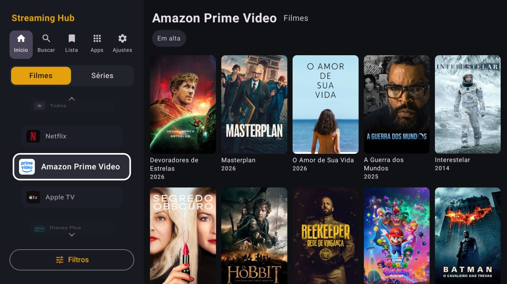
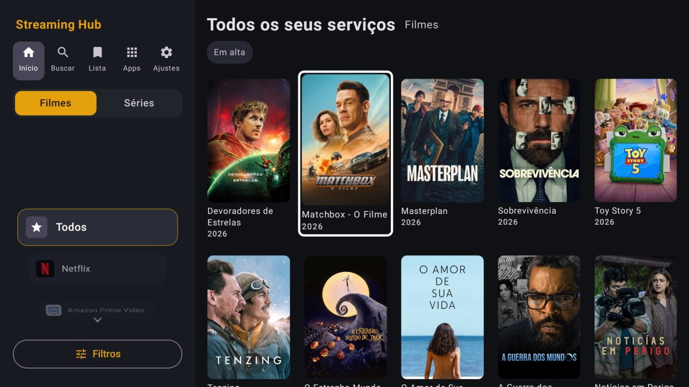
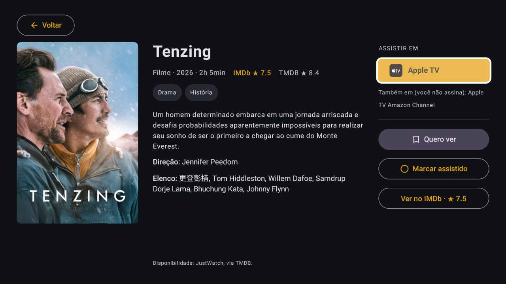
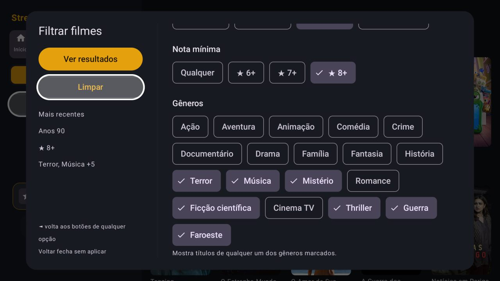
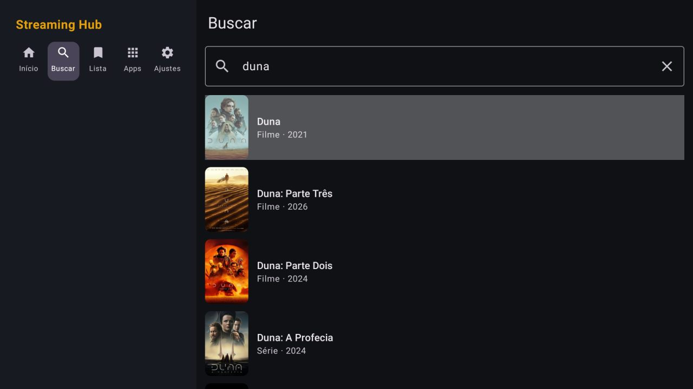

# Streaming Hub

Um hub pessoal para os serviços de streaming: um só lugar para descobrir, buscar e guardar filmes e séries, e abrir cada título direto no app certo (Netflix, HBO Max, Prime Video, Disney+, Paramount+, Apple TV, Globoplay...).

Roda no **celular** e no **Fire TV** com o mesmo APK: na TV o app troca para um layout próprio, pensado para o controle remoto.

## O que já faz

- **Início:** o que está em alta nos serviços que você assina, no Brasil, com Filmes/Séries, filtro por serviço e **Filtros** (ordenação, época, nota mínima, gêneros).
- **Buscar:** busca unificada de filmes e séries.
- **Detalhes:** sinopse, notas do IMDb e do TMDB, elenco e **onde assistir**, separado em "nos seus serviços", "em outros serviços" e "aluguel ou compra".
- **Abrir no app:** abre o título direto no app do serviço (links da JustWatch). Se não der, abre a busca do app ou o app com o título copiado; sem o app instalado, cai no navegador ou na loja.
- **Minha lista:** "Recentes", "Quero ver" e "Assistidos", guardados no aparelho.
- **Apps:** atalhos para os apps de streaming instalados.
- **Volta de onde parou:** filtros, Filmes/Séries, serviço escolhido e o último título aberto ficam salvos no aparelho. Ao voltar de um serviço de streaming, o Início reabre igual, mesmo que o sistema tenha fechado o app.
- **Jellyfin (mídia própria):** conecta ao seu servidor Jellyfin e o trata como mais um serviço: chip/dial no Início com "Continuar assistindo" e a biblioteca, botão "Assistir no Jellyfin" nos Detalhes de títulos que estão no servidor e resultados do servidor na Busca. Os vídeos tocam num **player embutido** (Media3), com legendas internas do arquivo e externas (.srt, .sub, .ass) e o progresso salvo no próprio Jellyfin.

## Na TV (Fire TV / Android TV)

- **Painel lateral fixo** com as seções, Filmes/Séries, Filtros e um **dial de serviços**: ▲▼ gira entre os serviços e as capas à direita acompanham.
- **Foco sempre visível** (moldura branca e leve zoom). ► do painel entra na capa onde você estava; ◄ da primeira coluna volta ao dial; ao voltar de um título, o foco volta para a capa aberta.
- **Detalhes em três colunas**, sem rolagem: capa grande, informações e uma coluna "Assistir em" com um botão por serviço.
- **Filtros em duas colunas**: "Ver resultados" e "Limpar" sempre à mão na esquerda.
- O teclado só abre quando você aperta OK num campo de texto, não ao passar por ele.

| Foco nas capas | Detalhes |
|---|---|
|  |  |

| Filtros | Buscar |
|---|---|
|  |  |

Testado num Fire TV Stick (3ª geração, Fire OS 7): o link direto abre o título certo em Netflix, Prime Video, HBO Max, Disney+ e Apple TV (os dois últimos pedem o perfil antes).

## Primeiro uso

1. Crie uma conta grátis em [themoviedb.org](https://www.themoviedb.org/) e gere uma chave em *Configurações → API*. Serve a "Chave da API" ou o "Token de leitura".
2. No app: **Apps → ⚙ Configurações** (na TV, **Ajustes** no painel), cole a chave e salve. Na TV, o teclado do Fire TV oferece um QR code para digitar pelo celular.
3. Marque os serviços que você assina.
4. (Opcional) Em Configurações → **Jellyfin**, toque em "Procurar na rede" ou digite o endereço (ex.: `192.168.0.10:8096`) e entre com usuário e senha. Na TV é mais fácil o **Quick Connect**: o app mostra um código de 6 dígitos e você aprova no Jellyfin pelo navegador (seu perfil → Quick Connect).

## Instalação

Cada push na `main` gera um APK pelo GitHub Actions e publica na aba **Releases**. Baixe o `.apk` mais recente no celular e instale. As versões novas instalam por cima das antigas, porque todos os builds usam a mesma chave de assinatura (`keystore/`, de uso pessoal, não é segredo).

No Fire TV (Fire OS), dá para instalar o mesmo APK com o app Downloader ou pelo PC via ADB (passo a passo em [`docs/AMBIENTE-LOCAL.md`](docs/AMBIENTE-LOCAL.md)).

## Limitações conhecidas

- Os serviços não oferecem API pública. O catálogo e a disponibilidade vêm do **TMDB** (dados da JustWatch), então não há "continuar assistindo" nem histórico real dos apps.
- Não há deep link oficial por ID. O app busca o link da página do título em cada serviço na API pública (não oficial) da JustWatch e abre direto nele. Se a JustWatch não tiver o link ou a API mudar, o app volta a abrir a busca/o app com o título copiado.
- Os pacotes dos apps variam entre celular, Android TV e Fire TV. A lista fica em `StreamingApps.kt`.
- Minha lista fica em cada aparelho: o que você marca no celular não aparece na TV.
- Jellyfin: legendas externas em imagem (.idx/.sub VobSub, .sup PGS) ainda não aparecem; as internas em imagem só no arquivo original. Se o aparelho não decodifica o vídeo ou o áudio, o servidor converte (mais lento e pesa na CPU do servidor).

## Stack

Kotlin, Jetpack Compose (Material 3), OkHttp + kotlinx.serialization, DataStore, Coil, Media3 (ExoPlayer). minSdk 26, targetSdk 35.

## Próximos passos

- Buscar, Minha lista e Apps com layout próprio na TV.
- Integração opcional com Trakt para histórico e progresso (e lista compartilhada entre aparelhos).
- Mais serviços e deep links validados por app.
